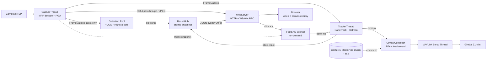

# PLAN: Gimbal Vision Server (C++ / RK3588 / RKNN / Web)

> Nền tảng giả định: **Orange Pi 5 Plus (RK3588, aarch64, NPU 3 core 6 TOPS, MPP/RGA phần cứng)** – đã kiểm tra trên máy.
> Tham chiếu: `Desktop/z1Camera_mavlink` (MAVLink + PID + NanoTrack, đã chạy được với Z1-Mini), `rknn-cpp-Multithreading` (pool RKNN đa luồng), `FastSAM_rknn_Cplusplus` (FastSAM RKNN).

---

## 1. Mục tiêu & yêu cầu phi chức năng

| # | Yêu cầu | Chỉ tiêu đề xuất |
|---|---|---|
| F1 | Đọc RTSP `rtsp://192.168.144.108` | decode phần cứng (MPP), tự reconnect |
| F2 | Object detection YOLO **luôn chạy**, luôn vẽ box | ≥ 25–30 FPS (yolov5s/yolov8n int8) |
| F3 | Click điểm trên web → FastSAM khoanh vùng → NanoTrack + Kalman | khởi tạo < 300 ms, box mượt |
| F4 | Web hiển thị video + box detection + box tracking | độ trễ glass‑to‑glass < 250 ms (mục tiêu ~150 ms) |
| F5 | Điều khiển gimbal PID qua MAVLink serial | vòng điều khiển 30–50 Hz |
| F6 | Mọi tham số (PID, serial, baud, RTSP, model…) trong **1 file config**, cố định khi chạy | `config/config.json`, đọc 1 lần lúc khởi động |
| F7 | (Sau) MediaPipe nhận diện cử chỉ tay | plugin, không ảnh hưởng luồng chính |

Nguyên tắc realtime: **luôn xử lý frame mới nhất, bỏ frame cũ** (không xếp hàng), mỗi module chạy luồng riêng, không module nào chặn module khác.

---

## 2. Kiến trúc tổng thể



### 2.1 Các luồng (thread)

| Thread | Việc | Ưu tiên / ghim CPU |
|---|---|---|
| `capture` | RTSP → decode (MPP) → RGA resize/convert → ghi `FrameMailbox` (frame_id, timestamp, buffer dma) | RT, big core A76 |
| `detect-pool` | N worker (N = 3, mỗi worker 1 `rknn_context` ghim `RKNN_NPU_CORE_0/1/2`) theo mẫu `rknn-cpp-Multithreading`; kết quả trả về theo thứ tự frame_id | big core |
| `tracker` | NanoTrack (RKNN) + Kalman; chạy mỗi frame khi đang track | big core |
| `fastsam` | Chờ request click, chạy 1 lần, trả mask/bbox | thường ngủ |
| `control` | Vòng PID 30–50 Hz cố định, đọc bbox đã lọc Kalman | RT |
| `mavlink-rx/tx` | Heartbeat 1 Hz, gửi lệnh, đọc attitude gimbal | thường |
| `web` | HTTP, WebSocket, phát video, nhận click | thường |
| `gesture` (sau) | MediaPipe | little core |

**Phân bổ NPU 3 core (đề xuất):** detection dùng core 0+1 (2 worker); core 2 dành cho NanoTrack + FastSAM (dùng chung, FastSAM chỉ chạy lúc click nên không tranh chấp đáng kể). Nếu detection chưa đủ FPS thì cho detection 3 worker và để tracker dùng chung core theo mutex ngắn. Quyết định sau khi benchmark ở giai đoạn 1.

### 2.2 Cấu trúc thư mục dự án

```
web/
├── PLAN.md  README.md
├── CMakeLists.txt  build.sh  run.sh
├── config/config.json            # TOÀN BỘ cấu hình (xem §6)
├── models/                       # yolo.rknn, fastsam.rknn, nanotrack_{backbone,head}.rknn
├── third_party/                  # mavlink (copy từ z1Camera_mavlink/include/mavlink), nlohmann json, civetweb/crow
├── include/ & src/
│   ├── core/       Config, FrameMailbox, ResultHub, Logger, Timer, ThreadUtil
│   ├── video/      RtspCapture (GStreamer/FFmpeg+MPP), RgaUtils
│   ├── ai/         RknnModel (wrapper), YoloDetector, DetectorPool,
│   │               FastSamSegmenter, NanoTrack, KalmanBox, TrackerManager
│   ├── control/    PIDController, MavlinkLink, GimbalController   (port từ z1Camera_mavlink)
│   ├── web/        WebServer, WsHub, VideoStreamer
│   ├── gesture/    (giai đoạn 5) IGestureSource, MediaPipeSource
│   └── main.cpp
├── www/            index.html, app.js (canvas overlay), style.css
├── tools/          convert_rknn.py, bench.cpp
└── docs/           INSTALL.md, USAGE.md, TUNING.md
```

### 2.3 Phương pháp lấy NGUYÊN từ source mẫu (đã đọc code) + chỗ cải tiến

**A. Detection – `rknn-cpp-Multithreading`** (README: yolov5s‑relu 41.6 FPS/1 luồng → 98.6 FPS/3 luồng → 140 FPS/12 luồng, đo trên video file)

| Kỹ thuật trong source mẫu | Áp dụng cho hệ thống |
|---|---|
| `rknn_init` model 0, các model còn lại `rknn_dup_context` (**chia sẻ weight**, tiết kiệm RAM, nạp nhanh) | Giữ nguyên |
| `rknn_set_core_mask` gán worker i → NPU core `i % 3` (`coreNum.hpp`) | Giữ nguyên: 3 worker = 3 core; core NPU luôn bận |
| Thread pool (`dpool`) + `std::future`; `put()` chọn model theo vòng, `get()` trả đúng thứ tự | Giữ cơ chế pool, **sửa** để không tích luỹ trễ (xem bên dưới) |
| Resize/letterbox bằng **RGA** (`rga_func.h`, `resize_rga`), input UINT8 NHWC | Giữ nguyên, nhưng nguồn là frame NV12 từ MPP (RGA làm luôn NV12→RGB+resize 1 bước) |
| Model **int8** (yolov5s‑relu: thay SiLU bằng ReLU để nhanh hơn) | Dùng yolov5s‑relu làm mặc định; đo thêm yolov8n/yolo11n từ `rknn_model_zoo` |
| Post‑process trên **int8 trực tiếp**: so ngưỡng bằng `qnt_f32_to_affine(threshold)` trước khi dequantize, chỉ dequantize ô vượt ngưỡng; NMS theo class | Giữ nguyên (đây là phần giúp CPU không thành nút thắt) |
| Nhánh **nosigmoid** (`rknn_model_zoo`): bỏ sigmoid khỏi model, dùng `unsigmoid(thresh)` | Dùng nếu model zoo hỗ trợ → "hiệu năng cực hạn" |
| `performance.sh`: cố định xung CPU/NPU/DDR | Giữ nguyên làm `tools/perf_mode.sh` (chạy lúc boot) |

Cải tiến bắt buộc cho realtime (mẫu chỉ tối ưu thông lượng):
1. Mẫu: hàng đợi `futs` **không giới hạn**, `get()` lấy kết quả cũ nhất theo thứ tự → nếu camera nhanh hơn NPU thì trễ tăng dần. **Sửa**: tối đa `N` frame đang xử lý (N = số worker); khi worker đầy thì **bỏ frame cũ, chỉ nhận frame mới nhất**. Kết quả gắn `frame_id`, hiển thị kết quả mới nhất có `frame_id` lớn nhất (cho phép trả không theo thứ tự).
2. Mẫu dùng `rknn_inputs_set / rknn_outputs_get` (có copy). **Nâng cấp** sau benchmark: `rknn_create_mem_from_fd` + `rknn_set_io_mem` (zero‑copy, dma‑buf từ MPP/RGA), output int8 giữ nguyên layout NATIVE.
3. Mẫu dùng `cv::VideoCapture`/`imshow` → thay bằng MPP/GStreamer + web.
4. SDK mẫu cũ (1.5.x) → dùng `librknnrt` mới nhất (≥ 2.x), cùng driver NPU trên board (kiểm `rknn_query SDK_VERSION`).

**B. Segmentation – `FastSAM_rknn_Cplusplus`** (chỉ có demo 1 ảnh; có sẵn `FastSAM_S.rknn` và `FastSAM-x_640x352.rknn`)

| Kỹ thuật trong source mẫu | Áp dụng |
|---|---|
| Model **FastSAM‑s**, input **640×352** (đúng tỉ lệ 16:9, ít tính toán hơn 640×640 ~45%) | Dùng `FastSAM_S.rknn` 640×352 (không dùng bản x – quá nặng) |
| RGA resize → `rknn_inputs_set` → `rknn_run` → `rknn_outputs_get` | Giữ nguyên |
| Post‑process: dequantize int8, sigmoid class (dùng `fast_exp`), decode DFL box theo mesh grid (`GenerateMeshGrid`), NMS (IOU), 32 hệ số mask, proto `seg` | Giữ nguyên decode + NMS |
| Mask = Σ coef[s]·proto[s] cho **mọi** instance rồi `cv::resize` | **Cải tiến**: chỉ tính mask cho các instance có bbox **chứa điểm click** (thường 1–5 cái thay vì hàng chục) → giảm mạnh thời gian CPU; dùng NEON cho tích vô hướng 32 chiều; crop mask theo bbox |
| Chạy trên 1 ảnh, không có prompt | **Tự viết**: chọn instance theo điểm click, bbox từ mask → khởi tạo NanoTrack |

FastSAM chạy **theo yêu cầu** (một lần mỗi click) và nạp sẵn lúc khởi động (không load model khi click) → không làm giảm FPS detection; chỉ cần đo "thời gian từ click đến có box".

**C. Quy tắc chung rút ra** – mọi model RKNN trong hệ thống đều theo cùng khuôn: `rknn_dup_context` + `set_core_mask` + RGA preprocess + int8 post‑process tối ưu + dma‑buf zero‑copy (giai đoạn tối ưu) + cố định xung.

**D. Chỉ tiêu phải đo ở Giai đoạn 0 (chưa có số liệu thực trên board này)**

| Hạng mục | Ngưỡng đạt |
|---|---|
| Detection 3 luồng, chạy riêng | ≥ 60 FPS (mẫu: ~98 FPS, yolov5s‑relu) |
| Detection + NanoTrack + decode MPP chạy đồng thời | detection ≥ 30 FPS, tracker ≥ 30 FPS |
| FastSAM‑s 640×352 (inference + post‑process) | ≤ 300 ms |
| Camera → trình duyệt | ≤ 200 ms |
Nếu không đạt: giảm input (480/416), giảm số worker detection, chạy detection cách frame (tracker vẫn mỗi frame), hoặc đổi model nhỏ hơn.

---

## 3. Thiết kế chi tiết từng module

### 3.1 Capture (RTSP)
- Dùng **GStreamer**: `rtspsrc latency=0 protocols=tcp(hoặc udp) ! rtph264depay ! h264parse ! mppvideodec ! appsink` (hoặc FFmpeg + `h264_rkmpp`). `appsink drop=true max-buffers=1 sync=false`.
- `rtspsrc latency=0`, tắt buffer; watchdog: không có frame > 2 s → dựng lại pipeline (backoff 1→5 s).
- Ra 2 dạng: (a) frame gốc NV12 dma‑buf cho web/tham chiếu, (b) frame RGB đã **RGA resize + letterbox** (640×640) cho YOLO, dùng zero‑copy `rknn_create_mem_from_fd` nếu có thể.
- `FrameMailbox`: ring 3–4 buffer, refcount (`shared_ptr`), consumer luôn lấy **frame mới nhất**; mỗi frame có `frame_id`, `t_capture` (steady_clock).

### 3.2 Object detection (luôn hoạt động)
- Model: YOLOv5s/YOLOv8n/YOLO11n → RKNN **int8** (rknn-toolkit2, dataset hiệu chuẩn ~200 ảnh từ camera thật). Post‑process (decode, NMS) viết C++ (tham khảo `rknn-cpp-Multithreading/postprocess`), dùng NEON cho phần thô.
- `DetectorPool`: theo mẫu repo tham khảo – queue + N worker, mỗi worker 1 context. **Điều chỉnh để latency thấp**: nếu repo gốc xếp hàng tuần tự thì ở đây thay bằng "worker rảnh nào lấy frame mới nhất" (bỏ frame đã cũ), kết quả đẩy vào `ResultHub` kèm `frame_id`.
- Đầu ra mỗi frame: `vector<Det{x1,y1,x2,y2, score, class_id, class_name}>`. **"id object" = class_id**; tuỳ chọn (giai đoạn 4) thêm *track_id* nhẹ bằng ByteTrack/IoU‑tracker cho box ổn định, mặc định tắt.
- Chạy độc lập, không phụ thuộc tracking → box detection luôn được vẽ.
- Làm mượt hiển thị: ở web có thể nội suy/EMA nhẹ box detection cùng `class_id` (client‑side) để giảm nhấp nháy.

### 3.3 Chọn đối tượng bằng FastSAM (click)
- Web gửi `{x,y}` chuẩn hoá (0..1) + `frame_id` đang xem → server quy ra pixel gốc.
- Lấy frame đúng/gần nhất `frame_id` từ mailbox (giữ lại snapshot) → FastSAM‑s RKNN (input 640, int8) → proto mask (32 hệ số) × coef → mask.
- Chọn instance: mask **chứa điểm click** có score cao nhất (ưu tiên diện tích nhỏ hơn nếu nhiều mask lồng nhau; fallback: bbox gần click nhất; fallback cuối: box cố định 80×80 quanh điểm). Làm sạch: morphology + connected component chứa điểm → `bbox = boundingRect(mask)`.
- Trả `{bbox, mask contour}` (contour hiển thị tạm trên web 1 s để người dùng thấy vùng đã chọn).
- Vì FastSAM mất vài chục–trăm ms, bbox khởi tạo lấy từ frame cũ → **bù**: khởi tạo NanoTrack trên chính frame đó, rồi chạy "bắt kịp" (replay) các frame trong mailbox tới frame hiện tại (hoặc 1–2 bước update liên tiếp).

### 3.4 Tracking: NanoTrack + Kalman
- NanoTrack V2/V3: backbone (template/search) + head → convert ONNX có sẵn trong `z1Camera_mavlink/models` sang RKNN (fp16 cho độ chính xác; int8 chỉ khi thử nghiệm thấy ổn). Port `NanoTrack.cpp` hiện có (đổi runtime ONNX/OpenCV‑DNN → RKNN).
- **Kalman (constant‑velocity)**, state `[cx, cy, w, h, vx, vy, vw, vh]`, đo = bbox NanoTrack:
  - R (nhiễu đo) **thích nghi theo score** của NanoTrack: score thấp → R lớn (tin dự đoán hơn).
  - Q nhỏ cho kích thước (w,h chậm đổi), lớn hơn cho vị trí.
  - Gating: bỏ đo nếu nhảy bất thường (Mahalanobis / IoU với dự đoán < ngưỡng).
  - Thêm **EMA / One‑Euro filter** lên bbox xuất ra web → chống rung hiển thị; PID dùng giá trị Kalman (ít trễ hơn One‑Euro).
- Máy trạng thái: `IDLE → SELECTING → TRACKING → (LOW_CONF → LOST) → IDLE`.
  - `LOW_CONF` (score < `min_score`): chỉ dự đoán Kalman tối đa `lost_timeout_ms`, gimbal giảm tốc về 0.
  - `LOST`: dừng gimbal, báo web; tuỳ chọn **tái định vị**: so khớp detection YOLO cùng class gần vị trí dự đoán nhất (IoU/khoảng cách) để khôi phục.
- Đầu ra: `TrackResult{valid, state, bbox, center, vx, vy, score, frame_id}`.
- Click khi đang track → huỷ track cũ, bắt đầu chọn mới. API `cancel` để huỷ.

### 3.5 Gimbal: PID + MAVLink
- Port gần như nguyên từ `z1Camera_mavlink`: `PIDController` (anti‑windup, lọc đạo hàm, dt clamp), `MAVLinkController` (termios serial, heartbeat, `MAV_CMD_DO_MOUNT_CONTROL`, `GIMBAL_DEVICE_SET_ATTITUDE`, `GIMBAL_MANAGER_SET_PITCHYAW`, đọc `GIMBAL_DEVICE_ATTITUDE_STATUS`). Giữ `target_sys=1, target_comp=154`.
- Sai số: `ex = (cx − W/2)/(W/2)`, `ey` tương tự, chuẩn hoá −1..1; deadband theo config; invert yaw/pitch theo config.
- Cải tiến: **feedforward** theo vận tốc Kalman (`u = PID(e) + Kff·v`), giới hạn gia tốc (slew‑rate limiter) để gimbal không giật, giới hạn `max_rate`, bù độ trễ (dự đoán vị trí tại thời điểm lệnh được thực thi = `t_now − t_capture`).
- Vòng điều khiển chạy tần số cố định (mặc định 30 Hz) trong thread riêng, **không phụ thuộc FPS web/detection**; mất track > timeout → lệnh rate = 0 (an toàn). Watchdog mất kết nối serial → thử mở lại.

### 3.6 Web: truyền video & overlay (quan trọng cho độ trễ)
Hai giai đoạn:

| Phương án | Mô tả | Độ trễ | Ghi chú |
|---|---|---|---|
| **A (MVP)** MJPEG | Frame NV12 → JPEG bằng **MPP JPEG encoder** (phần cứng) → `multipart/x-mixed-replace` hoặc WebSocket binary | ~100–200 ms | đơn giản, chạy mọi trình duyệt |
| **B (khuyến nghị)** H264 passthrough | Không decode/encode lại: chuyển NAL H264 từ RTSP sang trình duyệt qua **WebSocket + WebCodecs (VideoDecoder)** hoặc **WebRTC** (libdatachannel) | ~80–150 ms | tốn ít CPU nhất, chất lượng gốc |

- **Overlay vẽ phía client**: server gửi JSON qua WebSocket (~30 Hz):
  ```json
  {"frame_id":1234,"ts":1731462641.123,
   "det":[{"b":[x1,y1,x2,y2],"c":0,"n":"person","s":0.87}],
   "trk":{"state":"TRACKING","b":[x1,y1,x2,y2],"s":0.62},
   "gimbal":{"yaw":..,"pitch":..},"fps":{"det":28,"cap":30},"lat_ms":95}
  ```
  Canvas phủ lên `<video>/`; tọa độ chuẩn hoá nên không phụ thuộc kích thước hiển thị. Cách này tránh tốn CPU server để vẽ + encode lại và giữ video mượt dù AI chậm.
- Đồng bộ box ↔ video: gắn `frame_id`/PTS; client giữ buffer ngắn (2–3 frame) và vẽ box có `frame_id` gần nhất; nếu box trễ thì vẽ box mới nhất (độ lệch nhỏ chấp nhận được).
- Web server: **civetweb** hoặc **Crow/Drogon** (HTTP + WS) – chọn **Crow hoặc civetweb** để nhẹ. Giao diện tĩnh `www/`.
- API:
  - `GET /` – trang web; `WS /ws` – overlay + sự kiện; `GET /video` (MJPEG) hoặc `WS /video`.
  - `POST /api/select {x,y,frame_id}` – chọn đối tượng; `POST /api/cancel`; `POST /api/recenter`; `GET /api/status`.
- Web chỉ **hiển thị + click + vài nút** (Hủy track, Recenter); **không** có chỉnh tham số runtime (theo yêu cầu cấu hình cố định).

### 3.7 Mở rộng MediaPipe cử chỉ (làm sau)
- Interface `IGestureSource { poll() -> GestureCommand }` (`NONE, PAN_LEFT, PAN_RIGHT, TILT_UP, TILT_DOWN, RECENTER, STOP, SELECT_CENTER…`).
- `GimbalController` có `InputArbiter` ưu tiên: **Track > Gesture > Idle** (hoặc chế độ chọn bằng config `mode`).
- Cách triển khai khả thi trên RK3588: (1) MediaPipe C++/TFLite (XNNPACK, ~15 FPS trên CPU nhỏ), hoặc (2) chuyển model palm detection + hand landmark sang RKNN và tự viết phần phân loại cử chỉ (rule‑based theo landmark). Chạy trên frame resize nhỏ, 10–15 Hz, thread riêng ghim little core. Chống nhiễu: chỉ chấp nhận khi cử chỉ giữ ≥ N frame (debounce).
- Hiện chỉ để sẵn hook + mục `gesture` (enabled=false) trong config.

---

## 4. Tối ưu độ trễ & độ ổn định

1. **Latest‑frame‑wins** ở mọi hàng đợi; queue size = 1–2, drop frame cũ → độ trễ không tích luỹ.
2. **Zero‑copy**: MPP decode → dma‑buf → RGA (resize/CSC/letterbox) → RKNN (`rknn_set_io_mem`). Tránh `cv::resize/cvtColor` trên CPU.
3. **Ghim luồng**: `pthread_setaffinity_np` – A76 (core 4–7) cho capture/detect/tracker/control, A55 (0–3) cho web/mavlink; `SCHED_FIFO` nhẹ cho `control`. Governor `performance`, cố định xung NPU/CPU/DDR (script `tools/perf_mode.sh`).
4. **RKNN**: int8 YOLO, `rknn_set_core_mask` từng worker, multi‑batch không cần; bật `rknn_init` flag `RKNN_FLAG_ENABLE_SRAM` nếu có.
5. **Detection đa luồng 3 core** cho throughput; **tracker ưu tiên độ trễ** (không xếp hàng sau detection).
6. **Tách vòng điều khiển khỏi FPS AI**: control 30–50 Hz, dùng Kalman dự đoán giữa 2 lần đo.
7. **Đo độ trễ có hệ thống**: timestamp `t_capture` → `t_detect` → `t_send_ws`; hiển thị `lat_ms`, FPS trong web + log; benchmark tool.
8. **Ổn định**: reconnect RTSP/serial tự động, watchdog từng thread, systemd `Restart=always`, log xoay vòng, bắt SIGINT/SIGTERM (dừng gimbal an toàn: gửi rate 0), không cấp phát heap trong vòng nóng (object pool), tránh `std::mutex` lâu (dùng atomic shared_ptr / seqlock cho `ResultHub`).
9. **Mạng**: WebSocket bật `TCP_NODELAY`; nếu client chậm → drop gói overlay/video cũ (không buffer).
10. **Nhiệt độ**: log nhiệt SoC, cảnh báo ≥ 80 °C (quạt/tản nhiệt).

---

## 5. Lộ trình triển khai (giai đoạn)

| GĐ | Nội dung | Tiêu chí hoàn thành |
|---|---|---|
| 0 | Chuẩn bị: cài RKNN runtime/toolkit, MPP/RGA, GStreamer; convert & benchmark model (yolo, fastsam, nanotrack) | Model `.rknn` chạy được bằng tool bench, ghi lại FPS/latency |
| 1 | Capture RTSP + web MVP (MJPEG) + `FrameMailbox` | Xem được video trên web, trễ < 250 ms |
| 2 | Detection pool + `ResultHub` + overlay JSON/canvas | Box+class vẽ liên tục ≥ 25 FPS, không ảnh hưởng video |
| 3 | MAVLink + PID (port từ `z1Camera_mavlink`) + config file | Gimbal nhận lệnh rate/góc thử bằng API test |
| 4 | Click → FastSAM → NanoTrack(RKNN) + Kalman + state machine | Click chọn được vật, box ổn định, mất/lấy lại track đúng |
| 5 | Nối tracker → PID → gimbal (feedforward, bù trễ) | Gimbal bám mục tiêu mượt, không dao động |
| 6 | Tối ưu: H264 passthrough/WebRTC, zero‑copy, ghim CPU, systemd | Trễ glass‑to‑glass ≤ ~150 ms, chạy 24 h không lỗi |
| 7 | Tài liệu, test tích hợp, script cài đặt | `INSTALL.md`, `USAGE.md`, `TUNING.md` hoàn chỉnh |
| 8 | (Sau) MediaPipe gesture plugin | Điều khiển gimbal bằng cử chỉ |

Rủi ro chính: (1) convert FastSAM/NanoTrack sang RKNN gây lệch độ chính xác → dùng fp16 cho 2 model này; (2) cạnh tranh NPU giữa detection và tracking → benchmark & phân core; (3) độ trễ MJPEG → chuyển phương án B; (4) gimbal có độ trễ cơ khí → feedforward + giới hạn gia tốc.

---

## 6. File cấu hình mẫu `config/config.json` (cố định khi chạy)

```json
{
  "camera":  { "rtsp_url": "rtsp://192.168.144.108", "transport": "tcp", "latency_ms": 0,
               "width": 1280, "height": 720, "reconnect_ms": 2000 },
  "mavlink": { "endpoint": "/dev/ttyUSB0", "baud": 115200,
               "sys_id": 255, "comp_id": 190, "target_sys": 1, "target_comp": 154,
               "heartbeat_hz": 1 },
  "control": { "loop_hz": 30, "deadband": 0.04, "max_rate": 0.8, "max_accel": 3.0,
               "kp_yaw": 0.6, "ki_yaw": 0.0, "kd_yaw": 0.1, "invert_yaw": true,
               "kp_pitch": 0.6, "ki_pitch": 0.0, "kd_pitch": 0.1, "invert_pitch": true,
               "ff_gain": 0.3, "lost_timeout_ms": 500 },
  "detector":{ "model": "models/yolov8n.rknn", "labels": "models/coco.txt",
               "input_size": 640, "conf_thresh": 0.4, "nms_thresh": 0.45,
               "workers": 2, "npu_cores": [0, 1] },
  "segmenter":{ "model": "models/FastSAM_S.rknn", "input_w": 640, "input_h": 352,
                "conf_thresh": 0.4, "iou_thresh": 0.9, "npu_core": 2 },
  "tracker": { "backbone": "models/nanotrack_backbone.rknn", "head": "models/nanotrack_head.rknn",
               "min_score": 0.25, "npu_core": 2,
               "kalman": { "q_pos": 1.0, "q_size": 0.1, "r_base": 4.0, "r_score_scale": 20.0 },
               "output_smoothing": { "min_cutoff": 1.0, "beta": 0.02 } },
  "web":     { "bind": "0.0.0.0", "port": 8080, "video_mode": "mjpeg",
               "jpeg_quality": 75, "overlay_hz": 30 },
  "gesture": { "enabled": false },
  "system":  { "log_level": "info", "cpu_affinity": { "ai": [4,5,6,7], "io": [0,1,2,3] } }
}
```

Hàm `Config::load()` đọc, kiểm tra bắt buộc, báo lỗi rõ ràng và **thoát nếu thiếu/sai**; không có API sửa runtime.

---

## 7. Hướng dẫn cài đặt (dự kiến, sẽ hoàn thiện trong `docs/INSTALL.md`)

```bash
# 1. Gói hệ thống
sudo apt update
sudo apt install -y build-essential cmake git pkg-config libopencv-dev \
  libgstreamer1.0-dev libgstreamer-plugins-base1.0-dev gstreamer1.0-plugins-{good,bad,ugly} \
  gstreamer1.0-rockchip1 librga-dev librockchip-mpp-dev nlohmann-json3-dev

# 2. RKNN runtime (librknnrt.so + rknn_api.h) từ https://github.com/airockchip/rknn-toolkit2
sudo cp librknnrt.so /usr/lib/ && sudo cp rknn_api.h /usr/include/

# 3. Convert model (trên PC x86, rknn-toolkit2):  python tools/convert_rknn.py --onnx yolov8n.onnx --target rk3588 --int8 --dataset calib.txt
# 4. Cấp quyền serial
sudo usermod -aG dialout $USER   # đăng nhập lại

# 5. Build & chạy
./build.sh && ./run.sh           # mở http://<ip-orangepi>:8080
```
Chạy nền: `systemd` unit `gimbal-vision.service` (`Restart=always`, `CPUAffinity`, `Nice=-10`).

## 8. Hướng dẫn sử dụng (dự kiến)
1. Cấu hình `config/config.json` (RTSP, serial, baud, PID) rồi khởi động chương trình.
2. Mở trình duyệt `http://<ip>:8080` → thấy video + box object detection (màu xanh) + class.
3. **Click** vào vật thể → vùng FastSAM hiện ngắn → box tracking (màu đỏ) → gimbal tự bám.
4. Nút/phím: **Hủy track** (`C`), **Recenter** (`R`).
5. Trạng thái hiển thị: FPS, độ trễ, trạng thái track (`TRACKING/LOST`), kết nối serial/RTSP.
6. Chỉnh PID: sửa file config → khởi động lại (xem `docs/TUNING.md`: chỉnh Kp trước, rồi Kd, Ki gần 0).

## 9. Kiểm thử & nghiệm thu
- Unit: Kalman (chuỗi đo nhiễu → độ rung giảm ≥ 70%), PID (step response), parser config.
- Tích hợp: giả lập RTSP bằng file (`ffmpeg -re ... | mediamtx`), giả lập gimbal bằng `socat` PTY.
- Hiệu năng: bảng FPS/latency từng stage, CPU/NPU/nhiệt chạy 1 giờ, kiểm tra rò rỉ bộ nhớ.
- Chịu lỗi: rút RTSP/serial giữa chừng → tự khôi phục; mất track → gimbal dừng an toàn.

## 10. Câu hỏi cần xác nhận trước khi code
1. Board đích đúng là **RK3588 (OPi 5 Plus)**? Độ phân giải/codec camera (H264/H265, 720p/1080p)?
2. Bắt đầu với **MJPEG (nhanh)** rồi nâng H264/WebRTC, hay làm WebRTC ngay?
3. "id object" là **class id** (đề xuất) hay cần **track id** liên tục cho từng vật thể?
4. Có sẵn model `.rknn` (yolo/fastsam) chưa, hay cần hướng dẫn convert?

